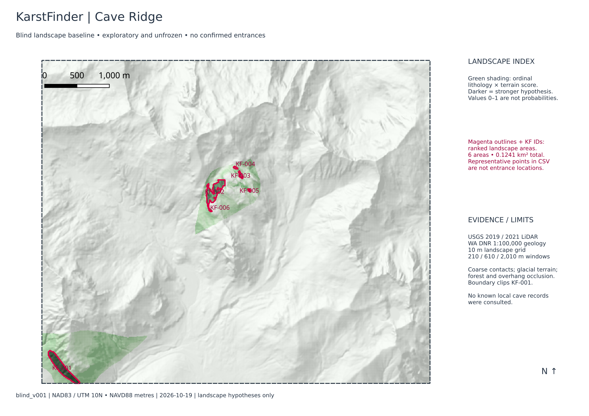
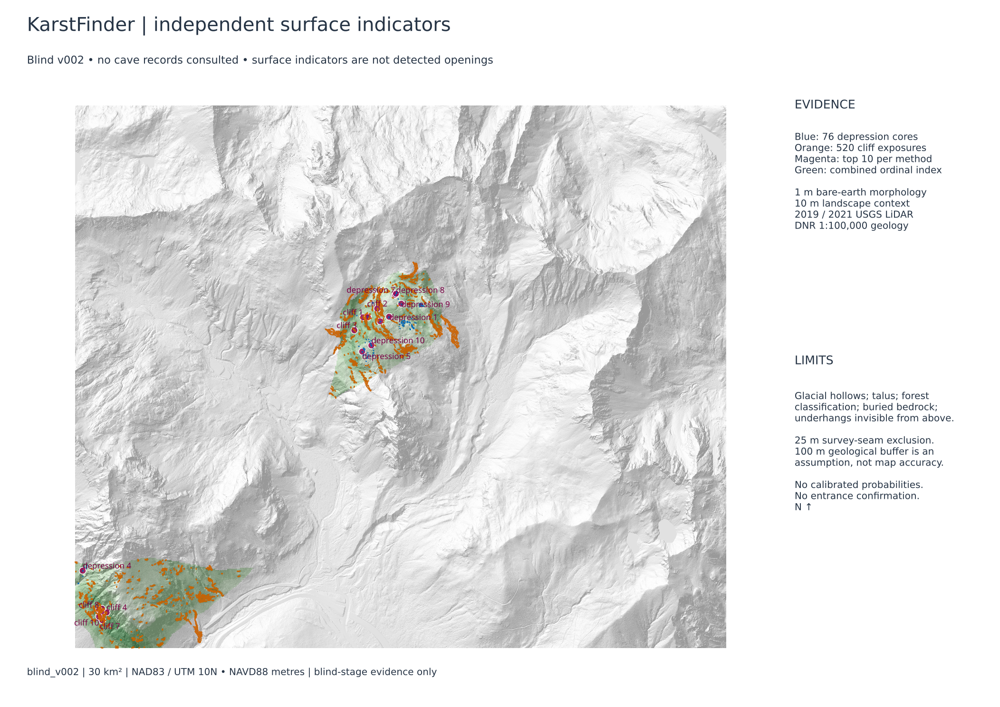
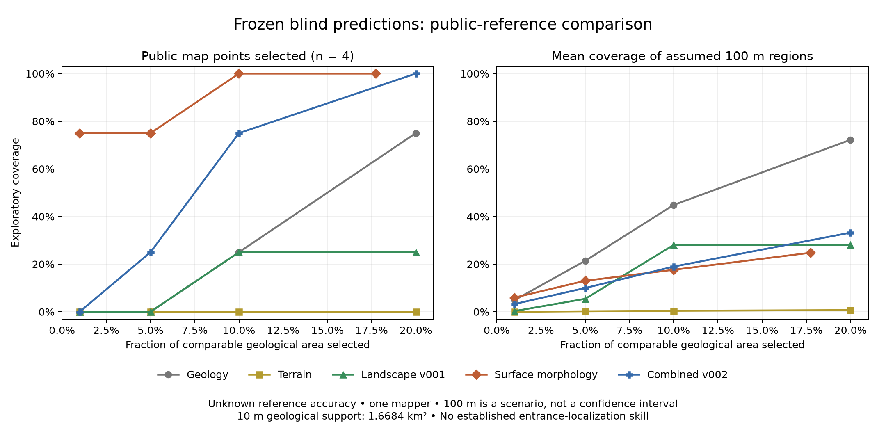
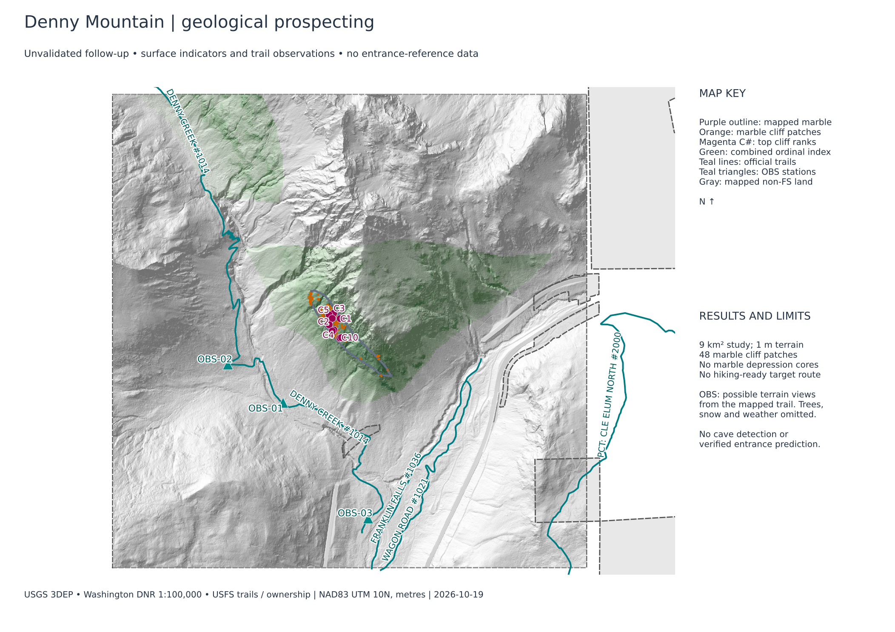

# KarstFinder

Reproducible geospatial research into cave-bearing landscapes near Cave
Ridge, Denny Mountain, Kaleetan Peak and Marble Peak near Silverton, Washington. Outputs describe **landscape
hypotheses, not cave locations or probabilities**. Initial predictions were frozen before known local cave references were consulted. Read [PROJECT_STATE.md](PROJECT_STATE.md) before work.

## Current maps: carbonate prospecting

KarstFinder targets **documented limestone/marble formations**. The corrected
`carbonate_v001` analysis admits mapped marble and a flagged 25 m contact margin;
unrelated terrain and broad uncertain mélange are excluded before detection.
Existing enhanced v001 is retained below as a historical comparison.

| Current Library map | Local prospecting sites | Scoped observations |
|---|---:|---:|
| [Cave Ridge](prospecting_library/cave-ridge-carbonate-v001/cave-ridge-carbonate-v001.qgz) | 57 | 212 |
| [Denny Mountain](prospecting_library/denny-mountain-carbonate-v001/denny-mountain-carbonate-v001.qgz) | 3 | 78 |
| [Kaleetan vicinity](prospecting_library/kaleetan-vicinity-carbonate-v001/kaleetan-vicinity-carbonate-v001.qgz) | 1 | 3 |
| [Marble Peak](prospecting_library/marble-peak-carbonate-v001/marble-peak-carbonate-v001.qgz) | 1 | 15 |

Every eligible site is visible; there are no scale-hiding or top-N filters.
Underlying observations remain inspectable. Drainage provides context but cannot
create, bridge or raise a destination's score. Exact continuous 0–1 colors and
specific surface reference coordinates are retained. These are unvalidated
prospecting sites, **not cave entrances**. Local shared datasets are required.

```bash
./library open denny-mountain-carbonate-v001
./library verify denny-mountain-carbonate-v001
```

[Methodology](docs/carbonate_v001/METHODOLOGY.md),
[results and geological limits](docs/carbonate_v001/RESULTS.md),
[map workflow](docs/carbonate_v001/WORKFLOW.md), and
[audit](docs/carbonate_v001/verification.json) explain the correction.
All original/enhanced results, maps, Library entries and freezes are preserved.

## Archived enhanced prospecting maps

The additive **enhanced_v001** analyses retain every original lead and add
terrain/drainage hypotheses with exact continuous purple → blue → teal → green → yellow
strength colors, separate geological uncertainty, source-unit zones and native
0.6 m RGB/NIR imagery. Strength is an ordinal index, **not a cave probability**.
Original Library entries and frozen experiments remain intact.

Open [enhanced Denny](prospecting_library/denny-mountain-enhanced-v001/denny-mountain-enhanced-v001.qgz),
[enhanced Kaleetan](prospecting_library/kaleetan-vicinity-enhanced-v001/kaleetan-vicinity-enhanced-v001.qgz),
[enhanced Marble Peak](prospecting_library/marble-peak-enhanced-v001/marble-peak-enhanced-v001.qgz), or
[enhanced Cave Ridge](prospecting_library/cave-ridge-enhanced-v001/cave-ridge-enhanced-v001.qgz).
Use the [workflow and filters](docs/enhanced_v001/WORKFLOW.md),
[scoring methodology](docs/enhanced_v001/METHODOLOGY.md), and
[comparison](docs/enhanced_v001/COMPARISON.md) to review evidence and limitations.
Maps require the local shared datasets. Optional native LiDAR is partial at Marble;
the other three areas use the DEM fallback within the declared download budget.
No new cave-reference sources or personal field observations were used.

## Saved prospecting areas

The [Prospecting Library](prospecting_library/README.md) keeps independent,
versioned QGIS maps and a JSON catalog. Open
[Denny Mountain](prospecting_library/denny-mountain/denny-mountain.qgz) or
[Cave Ridge](prospecting_library/cave-ridge/cave-ridge.qgz),
[Kaleetan Peak vicinity](prospecting_library/kaleetan-vicinity/kaleetan-vicinity.qgz), or
[Marble Peak / upper Marble Gulch](prospecting_library/marble-peak/marble-peak.qgz) directly in QGIS with
**Project → Open**. No Codex or analysis rerun is needed. These are local projects
using shared datasets under `data/` and `results/`, **not portable data packages**;
the GitHub repository alone excludes the large required datasets.

```bash
./library list
./library open denny-mountain        # through the live QGIS MCP plugin
./library save denny-mountain        # preserve the current map as a new version
./library verify denny-mountain      # independent reopen and data checks
```

Ask Codex to save/open an area, update its fieldwork status, or record a candidate
observation. [Library instructions](prospecting_library/README.md) explain new-area
registration, private local field notes, version history, backup and path recovery.
Predictions and frozen experiments stay separate from subsequent observations.

The two newly approved 9 km² studies are complete. Their default maps highlight
two Kaleetan and five Marble Peak cliff patches intersecting mapped marble;
one Marble patch has only a small contact-edge overlap. Neither lens has a modeled
depression core. These are unverified surface indicators, not detected entrances.
[Results, map previews and review evidence](docs/APPROVED_AREAS_RESULTS_20261019.md)
explain the source coverage, original ranks and limitations. Both new maps have
overview and marble-detail print layouts and retain the full indicator tables.
[The final Marble provider review](docs/MARBLE_PROVIDER_REVIEW_20261019.md) preserves
a container-byte change and its unchanged geological contents.

## Setup on Arch Linux

Use the repository open in VS Code: `/home/Idiom/Repos/MyRepos/KarstFinder`.
The original brief's `~/Projects` location was superseded by the user.

System prerequisites: QGIS with PyQGIS, GDAL with Python bindings, NumPy, SciPy,
Python, Git, Matplotlib for aggregate plots, and optionally Poppler for technical-report text extraction. GRASS
and SAGA runtimes are absent; the QGIS GRASS provider listing alone is not proof
that GRASS algorithms can execute. Rasterio, GeoPandas and scikit-learn are not
required for this baseline.

```bash
python -m venv --system-site-packages .venv
uv pip install --python .venv/bin/python -r requirements.lock
uv pip install --python .venv/bin/python --no-deps -e .
.venv/bin/python -m pytest -q
```

Whitebox's Python wrapper downloads the open WhiteboxTools binary on first use.
The observed binary version/hash is recorded with the run. Source system GIS
versions are recorded under `docs/`; exact replays require compatible packages
and the recorded binary. Do not pip-install another GDAL or Qt into this venv.

## Reproduce

```bash
.venv/bin/python scripts/acquire.py
.venv/bin/python scripts/acquire_supplemental.py
.venv/bin/python scripts/prepare.py
.venv/bin/python scripts/run_baseline.py
QT_QPA_PLATFORM=offscreen .venv/bin/python scripts/make_qgis_project.py
```

Downloads are cached and checksummed. Acquisition manifests contain exact URLs;
source files, processing outputs and local validation data are ignored by Git.
About 1.5 GB of disk is needed initially; allow extra space for repeat experiments.
The model refuses to overwrite an existing run. To repeat locally, use
`--output results/blind_v001_repeat`, then pass the same results path to
`make_qgis_project.py --results results/blind_v001_repeat`. That command updates
the review project to the specified run; it does not freeze an experiment.
Run acquisition scripts in the listed order: the supplemental script merges
its records into the acquisition manifest created by the primary script.

Open `qgis/KarstFinder.qgz` in QGIS. To load it through the running QGIS MCP
plugin, run `.venv/bin/python scripts/review_in_qgis.py`; it preserves another
open session before loading. Use `.venv/bin/python scripts/verify_results.py`
for artifact checks. All map layers are persistent local files;
no web basemap or Codex session is needed. The imagery and data files must remain
at their relative locations. GeoTIFFs and candidate GeoPackages are under
`results/blind_v001/`; original terrain/context data are under `data/`.

## Research records

- [RESEARCH.md](RESEARCH.md): sources, assumptions and transfer limits.
- [METHODOLOGY.md](METHODOLOGY.md): datasets, algorithms, assumptions, scoring and Denny cliff evidence.
- [EXPERIMENTS.md](EXPERIMENTS.md): run history and empirical results.
- [docs/DATASETS.md](docs/DATASETS.md): provenance, coverage, units and uncertainty.
- [AGENTS.md](AGENTS.md): instructions that protect the blind experiment.

M1–M3 are delivered, including complementary native feature analysis and a
final blind freeze. The current dependency is M4 reference quality; supervised
learning and geographic expansion remain conditional on credible validation.



## Complementary native analysis

The continuation adds independent closed-depression and cliff/outcrop indicators,
a combined ranking, descriptive terrain clustering and survey-seam controls:

```bash
.venv/bin/python scripts/native_qa.py
.venv/bin/python scripts/derive_features.py
.venv/bin/python scripts/run_features.py
QT_QPA_PLATFORM=offscreen .venv/bin/python scripts/feature_project.py
.venv/bin/python scripts/verify_features.py
```

These commands describe the original blind build. **Do not overwrite frozen
input/output directories when reproducing or improving a completed experiment.**
Use a separate checkout/data/output tree for later experiments. Baseline and v002
QGIS review projects are retained as `qgis/KarstFinder_Blind_v001.qgz` and
`qgis/KarstFinder_Blind_v002.qgz`; `qgis/KarstFinder.qgz` is the active review copy.
Known-cave reference data and detailed validation remain ignored under
`data/private/validation/`. The validator refuses to read them without verifying
the immutable freeze manifest first.




## Current validation status

M1–M3 are delivered; v002 is frozen. The public-reference comparison is documented
in [the validation report](docs/VALIDATION_REPORT.md). Four public mapped entrance
records have unknown positional accuracy and a common mapper; none qualifies for
the predeclared entrance-localization test. Apparent map-point agreement is
exploratory. The user permanently prohibits outreach; no one has been contacted.
The earlier unsent request has been withdrawn.

The local-only validation project is
`data/private/validation/KarstFinder_Validation.qgz` (39 valid persistent layers).
Reproduce permitted local comparisons using the public-source acquisition and
evaluation scripts below. Each reference-reading analysis verifies the frozen
experiment first. Exact references, diagrams and coordinates remain outside Git.
The full-study OSM envelope is clipped to the projected study boundary during
import. Source URLs and checksums are saved in a local-only acquisition manifest.

```bash
.venv/bin/python scripts/acquire_public_validation.py
.venv/bin/python scripts/import_public_validation.py
.venv/bin/python scripts/evaluate_frozen.py
.venv/bin/python scripts/evaluate_historical_region.py
.venv/bin/python scripts/evaluation_audit.py
.venv/bin/python scripts/plot_validation.py
QT_QPA_PLATFORM=offscreen .venv/bin/python scripts/validation_project.py
```

Do not regenerate the private GeoPackage while editing its layers in QGIS; save
and close it first. Reopen the resulting private project after rebuilding it.



## Approved Denny Mountain follow-up

The current working map is the user-approved southern Denny Mountain study.
Open [qgis/KarstFinder_Denny_v001.qgz](qgis/KarstFinder_Denny_v001.qgz) or
qgis/KarstFinder.qgz. It contains no known-entrance reference layers.
[Results and trail observation notes](docs/DENNY_RESULTS.md) describe 48 mapped-
marble cliff patches, the absence of marble depression cores, and three possible
observation stations on the official Denny Creek trail. No off-trail approach
is verified; the GPX contains trail observation waypoints only.

This is unvalidated prospecting, not demonstrated cave prediction. The approved
9 km² window overlaps the old study edge. Model scales, thresholds and weights
were transferred unchanged. Public trail/ownership context and GDAL bare-earth
viewsheds support separate access screening; canopy visibility is unknown.

Reproduction commands below refer to the original build and refuse existing
analysis directories. Use a separate checkout/data/output tree to replay finalized
products. Do not delete or overwrite either experiment's retained outputs.

```bash
.venv/bin/python scripts/acquire_denny.py
.venv/bin/python scripts/prepare.py --config configs/denny_v001_landscape.json
.venv/bin/python scripts/run_baseline.py --config configs/denny_v001_landscape.json --output results/denny_v001_landscape
.venv/bin/python scripts/native_qa.py --config configs/denny_v001_features.json
.venv/bin/python scripts/derive_features.py --config configs/denny_v001_features.json
.venv/bin/python scripts/run_features.py --config configs/denny_v001_features.json --output results/denny_v001_features
.venv/bin/python scripts/screen_denny_access.py
.venv/bin/python scripts/denny_observation_points.py
QT_QPA_PLATFORM=offscreen .venv/bin/python scripts/make_denny_project.py
```

For the independent numerical repeat, run baseline and feature commands with
`--output results/denny_v001_landscape_repeat` and
`--output results/denny_v001_features_repeat`, respectively. Also run
`screen_denny_access.py --output results/denny_v001_access_repeat --report docs/experiments/denny_v001_access_repeat_summary.json`. Then run
`QT_QPA_PLATFORM=offscreen .venv/bin/python scripts/verify_denny.py`.
The source paths are configurable in the two Denny configurations; baseline
script defaults still identify the historical Cave Ridge build.



The finalized prospecting artifact hashes are in
[experiments/snapshots/denny_v001.json](experiments/snapshots/denny_v001.json).
This is an unvalidated snapshot, distinct from the original blind freeze. It
records post-review GeoPackage hashes and its committed implementation. Numerical
result directories are write-protected; use the active QGIS copy for map review.

The current methodology and unchanged rankings have an additive
[independent-review record](docs/reviews/denny_v001_methodology/README.md). It
contains full-precision CSV copies, exact configurations, per-object score
contributions and hashes. Check it without rerunning models or accessing cave
references using `.venv/bin/python scripts/audit_denny_methodology.py --verify`.
